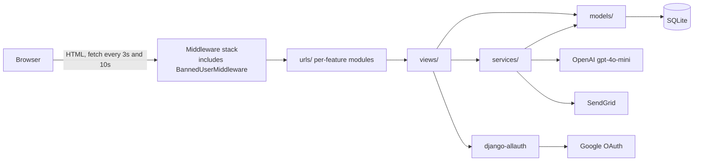
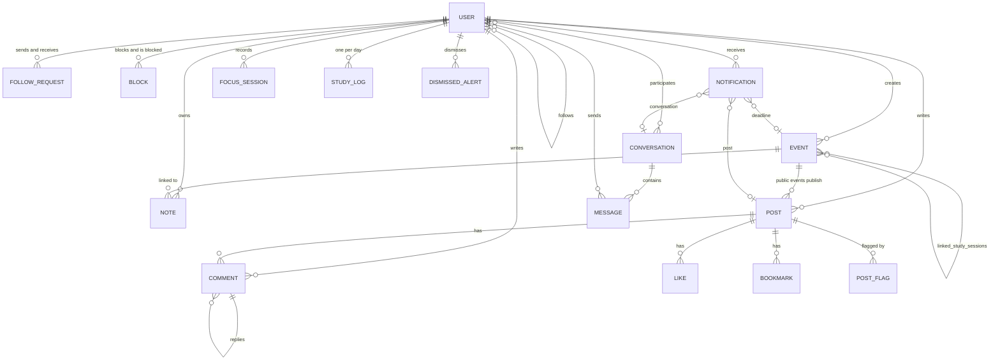

# Timeout: Project Overview

Timeout is a server-rendered Django web app for university students. It combines a calendar, deadlines, rich-text notes, a Pomodoro and focus timer, gamification, a social feed, direct messaging, statistics and optional AI planning. It was built by a seven-person King's College London team (Galatasaray CS) between 11 February and 30 March 2026.

**How this was checked.** This comes from reading the code, `git log`, the README, `developers-manual.pdf` and the project report, plus running the test suite and the app in production mode on 9 November 2026. Where the docs and the code disagree, the code wins, and [section 9](#9-where-the-docs-and-the-code-disagree) lists the differences.

| At a glance | |
|---|---|
| Backend | Django 6.1.3, one app: `timeout`; project package: `timeout_pwa` |
| Frontend | Django templates, Bootstrap 5.3, vanilla JS, Chart.js and Quill from a CDN, no build step |
| Database | SQLite (some code is SQLite-specific, see [section 8](#8-technically-interesting-parts-interview-talking-points)) |
| Application code | About 7,600 lines of Python excluding tests and migrations, 3,900 of JS, 7,500 of CSS, 44 templates |
| Tests | 1,206 passing at 97% line coverage |
| Live demo | https://timeout.ozankaya.net, on Docker behind host nginx |
| Models / migrations | 16 concrete models, 34 migrations (several are merges from parallel branches) |

---

## 1. Features and where they live

All features are in the single `timeout` app. Paths below are relative to `timeout/` unless they start with `static/`.

| Feature | What it does | Views | Services | Models | Frontend |
|---|---|---|---|---|---|
| **Landing and dashboard** | Public landing page; dashboard with greeting, upcoming events, deadlines, recent notes, unread count, feed preview, focus stats and AI briefing | [views/pages.py](timeout/views/pages.py) | `EventService`, `DeadlineService`, `FeedService`, `AIService` | most | [dashboard.html](timeout/templates/pages/dashboard.html) |
| **Calendar** | Month grid, event CRUD, read-time recurrence expansion, global events, subscribing to public events, deadline warnings | [views/calendar.py](timeout/views/calendar.py), [event_actions.py](timeout/views/event_actions.py), [event_edit.py](timeout/views/event_edit.py), [event_delete.py](timeout/views/event_delete.py), [event_details.py](timeout/views/event_details.py), [deadline_warning.py](timeout/views/deadline_warning.py) | [event_service.py](timeout/services/event_service.py) | `Event`, `DismissedAlert` | [calendar.js](static/js/calendar.js), [event_details.js](static/js/event_details.js) |
| **Deadlines list** | Filter, sort, mark complete or incomplete; urgency labels and "time left" strings | [views/deadlines.py](timeout/views/deadlines.py) | [deadline_service.py](timeout/services/deadline_service.py), [utils.py](timeout/utils.py) | `Event` | [deadlines.js](static/js/deadlines.js) |
| **AI: add event** | Natural language to a structured event | [views/ai_calendar.py](timeout/views/ai_calendar.py) | [openai_service.py](timeout/services/openai_service.py) | `Event` | [ai_calendar.js](static/js/ai_calendar.js) |
| **AI: plan study** | Finds free slots before a deadline, optionally lets GPT place sessions, user confirms | [views/study_planner.py](timeout/views/study_planner.py) | [study_planner.py](timeout/services/study_planner.py) | `Event` | [study_planner.js](static/js/study_planner.js) |
| **AI: reschedule** | Redistributes upcoming study sessions or suggests one new slot; preview, then apply | [views/ai_reschedule.py](timeout/views/ai_reschedule.py), `apply_session_schedule` in event_actions | `openai_service`, `DeadlineService` | `Event` | [reschedule_sessions.js](static/js/reschedule_sessions.js) |
| **AI: briefing, suggestions, workload** | Weekly dashboard briefing (cached 24h); daily tips and overload warning on the calendar (cached 1h) | [ai_suggestions.py](timeout/views/ai_suggestions.py), [ai_workload.py](timeout/views/ai_workload.py) | [ai_service.py](timeout/services/ai_service.py) | `Event` | templates |
| **Notes** | Quill editor, categories, pinning, search, sort, link to event, share as post, paged or pageless layout, 2-second autosave | [views/notes.py](timeout/views/notes.py) | [note_service.py](timeout/services/note_service.py) | `Note` | [note_editor.js](static/js/note_editor.js), [notes.js](static/js/notes.js) |
| **Pomodoro and focus mode** | Configurable timer that survives page navigation; focus mode hides navigation and records a session | [notes_productivity.py](timeout/views/notes_productivity.py), `update_status` in [social_follow.py](timeout/views/social_follow.py) | `NoteService` | `FocusSession`, `StudyLog`, `Note.time_spent_minutes` | [pomodoro.js](static/js/pomodoro.js), [focus_mode.js](static/js/focus_mode.js), [pomo_break_guard.js](static/js/pomo_break_guard.js) |
| **Gamification** | XP, levels (`floor(sqrt(xp / 50))`), note streaks, heatmap, daily goals | [notes_productivity.py](timeout/views/notes_productivity.py) | `NoteService` | `User`, `StudyLog` | notes templates |
| **Social feed** | Following, discover and bookmarks tabs, post privacy, likes, threaded comments, load-more pagination | [social_posts.py](timeout/views/social_posts.py) | [feed_service.py](timeout/services/feed_service.py) | `Post`, `Comment`, `Like`, `Bookmark` | [social.js](static/js/social.js) |
| **Follows, blocks, status** | Public follow, follow requests for private profiles, two-way block filtering, user search, status | [social_follow.py](timeout/views/social_follow.py), [social_api.py](timeout/views/social_api.py), [social_profile.py](timeout/views/social_profile.py) | [social_service.py](timeout/services/social_service.py) | `User.following`, `FollowRequest`, `Block` | [profile.js](static/js/profile.js), [user_profile.js](static/js/user_profile.js) |
| **Moderation** | Users flag posts; staff approve or deny flags and ban users | [moderation.py](timeout/views/moderation.py), [decorators.py](timeout/decorators.py), [middleware.py](timeout/middleware.py), [admin/](timeout/admin/) | `NotificationService` | `PostFlag`, `User.is_banned` | [moderation.js](static/js/moderation.js) |
| **Messaging** | One-to-one conversations, read state, 3-second polling | [views/messaging.py](timeout/views/messaging.py) | `SocialService`, `NotificationService` | `Conversation`, `Message` | [social_messaging.js](static/js/social_messaging.js) |
| **Notifications** | Deadline and event alerts plus social alerts, 10-second badge polling, read and dismiss | [views/notifications.py](timeout/views/notifications.py) | [notification_service.py](timeout/services/notification_service.py) | `Notification` | [notifications.js](static/js/notifications.js), [notification_poll.js](static/js/notification_poll.js) |
| **Statistics** | Event mix, weekly and monthly counts, urgent events, focus charts, leaderboard among followed users | [views/statistics.py](timeout/views/statistics.py) | none | `Event`, `FocusSession` | [statistics.js](static/js/statistics.js) |
| **Profile and settings** | Profile edit and picture, username change, password change, account deletion, theme, colourblind modes, font size, Pomodoro settings | [views/profile.py](timeout/views/profile.py), [views/settings.py](timeout/views/settings.py) | none | `User` | [settings.js](static/js/settings.js), [theme-init.js](static/js/theme-init.js) |
| **Auth** | Email signup, email or username login, Google OAuth, profile completion, 6-digit password reset | [views/auth.py](timeout/views/auth.py), [password_reset.py](timeout/views/password_reset.py), [adapters.py](timeout/adapters.py) | [email_service.py](timeout/services/email_service.py) | `User` | [auth-scripts.js](static/js/auth-scripts.js) |

---

## 2. Architecture

### Models and relationships

- [user.py](timeout/models/user.py): `User` extends `AbstractUser` with profile, preferences, Pomodoro settings, daily goals, XP and streak fields, ban state, and the self-referencing `following` relation.
- [mixins.py](timeout/models/mixins.py): `TimestampMixin`, `CreatedAtMixin`, and `OwnedMixin` (`can_edit`, `can_delete`).
- Uniqueness is enforced on `Like`, `Bookmark`, `FollowRequest`, `Block`, `PostFlag`, `StudyLog` (user and date) and `DismissedAlert`.
- [event.py:134](timeout/models/event.py:134): `Event.save()` keeps a linked `Post` in sync with the event's visibility.
- Likes, bookmarks and comments create notifications through `post_save` receivers defined next to their models.

### Services layer

Business logic is pulled out of views into plain modules with static methods, in [services/](timeout/services/):

| Service | Responsibility |
|---|---|
| `FeedService` | Feed querysets with privacy and block filtering, cursor pagination |
| `SocialService` | Follow and block state, profile visibility, user search |
| `NoteService` | Note queries, XP and streaks, `StudyLog` counters, heatmap, daily progress |
| `DeadlineService` | Deadline filtering, completion, urgency display data |
| `EventService` | Dashboard events, building an unsaved `Event` from normalised data |
| `NotificationService` | Time-based alerts with de-duplication, social notifications |
| `AIService`, `openai_service` | Weekly briefing and its cache; the shared OpenAI call and JSON parsing |
| `study_planner` | Free-slot calculation and even session spacing, with no AI involved |
| `EmailService` | Password-reset email through SendGrid |

The boundary isn't strict. Some logic stays in views (`views/calendar.py`, `views/statistics.py`), and `AIService` imports from `views/ai_suggestions.py` and `views/ai_workload.py`, so a service depends on a view.

### Authentication

There are two stacks side by side:

1. **Custom views used by the UI:** `/signup/`, `/login/` and `/logout/` in [views/auth.py](timeout/views/auth.py), with forms in [forms/auth.py](timeout/forms/auth.py). Signup takes an email and password and assigns a temporary `user_<hex>` username, then a session flag sends the user to `/complete-profile/`. Login accepts an email or a username.
2. **django-allauth under `/accounts/`:** used for Google OAuth. [adapters.py](timeout/adapters.py) redirects after signup and auto-links a Google login to an existing account with the same email through `pre_social_login`. allauth's own account routes are reachable too.

Other details:

- **Sessions only.** Auth uses Django session cookies.
- **JWT is not used.** No application code references it. `pyJWT` and `cryptography` appear only as dependencies, and the app has no API tokens.
- **Passwords:** Argon2 is the primary hasher, plus a custom strength check and similarity check.
- **Authorisation:** `@login_required`, `@staff_required`, per-object ownership filters, and `BannedUserMiddleware`, which logs out banned users on every request.
- **Password reset:** a 6-digit code stored in the session and emailed via SendGrid, valid for 5 minutes and discarded after 5 wrong attempts.
- **Shared demo account:** `is_demo_account` in [utils.py](timeout/utils.py) blocks password changes, username changes and deletion for the public `demo` login, so visitors can't lock each other out.
- **Unused providers:** GitHub and Discord are still in `INSTALLED_APPS`, and the landing page still mentions them, but the login UI only offers Google.

### PWA

**The app has no PWA features today.** There is no web manifest, service worker or install prompt in the current tree or in git history, and no offline support. `timeout_pwa` is only the Django project's name. The report lists PWA deployability as a non-functional requirement, but it was never built. What exists is a responsive layout and an `apple-touch-icon`.

### External integrations and what breaks without keys

The app starts and all non-AI features work with no keys. Settings read the keys from the environment and `.env`.

| Key missing | Effect |
|---|---|
| `OPENAI_API_KEY` | The live demo runs without one. The **dashboard** and the calendar's **AI modals** show "AI features are disabled on this demo deployment", and the AI buttons are disabled. **AI add event** and both **reschedule** endpoints return that message with a 200 status. **Calendar tips and workload warning** are empty. **Plan Study still works**, using the non-AI evenly spaced slots. |
| `SENDGRID_API_KEY`, `SENDGRID_FROM_EMAIL` | The forgot-password page shows "Failed to send the reset code", so password reset is effectively unavailable. Nothing else sends email. |
| `GOOGLE_CLIENT_ID`, `GOOGLE_CLIENT_SECRET` | The Google button is hidden through the `google_oauth_available` template tag. Email login is unaffected. |

Other external dependencies are Bootstrap, Bootstrap Icons, Chart.js and Quill from jsDelivr and fonts from Google Fonts. These load at runtime in the browser.

---

## 3. Data seeding

`nix run .#init` (in [flake.nix](flake.nix)) runs `migrate --run-syncdb`, then `init_site`, then `seed`.

- **[seed.py](timeout/management/commands/seed.py)** creates the `Site` record, an optional Google `SocialApp`, the `johndoe` superuser and the non-admin `demo` user with the same hand-written schedule, 80 Faker students, follow relationships, 160 events, 200 posts, comments, likes, bookmarks, 14 days of focus sessions, global events, 8 to 60 notes per user, 16 weeks of study logs, XP and streaks, and conversations.
- **[unseed.py](timeout/management/commands/unseed.py)** deletes all users and related data (`--keep-super` keeps `johndoe`), then resets the `Site` record.
- **[init_site.py](timeout/management/commands/init_site.py)** and **[check_site.py](timeout/management/commands/check_site.py)** set up and diagnose the `Site` and `SocialApp` records.
- **[check_notifications.py](timeout/management/commands/check_notifications.py)** generates alerts for all users. It's built for cron, though the app also generates them when users poll.
- **[bootstrap_demo.py](timeout/management/commands/bootstrap_demo.py)** runs `seed` once, in one transaction, only when the database has no users. The container entrypoint calls it on every start.
- **[reseed_demo.py](timeout/management/commands/reseed_demo.py)** replaces demo data on a deployed site. It refuses to run if accounts exist that seeding didn't create, backs up the database, then runs `unseed` and `seed` in one transaction.

Things to know:

- **`seed` is not idempotent.** Each direct run adds another 80 users and the rest of the data, and deletes and recreates `Site` records.
- **Environment overrides:** `SITE_DOMAIN`, `SITE_NAME` and `SEED_SUPERUSER_PASSWORD` replace the local defaults. The default superuser password is public, so any public deployment must set its own.
- **Dates are relative to seed time.** Each showcase account gets last week's completed classes, two completed deadlines, one overdue deadline and a mostly upcoming schedule. Nothing marks events done as time passes, so past classes and deadlines start showing as overdue within days of seeding.
- **The flake only targets `x86_64-linux`,** so `nix run` won't work on a Mac or an ARM server.

---

## 4. Test setup and coverage

- **Runner:** Django's `manage.py test`. Tests are under [timeout/tests/](timeout/tests/), grouped into `models/`, `services/`, `views/`, `forms/`, `admin/` and `management/`, plus top-level coverage files.
- **Command:** `nix run .#tests` runs the suite under `coverage`, then writes an HTML report to `./coverage/` and prints a summary.
- **External calls:** OpenAI and SendGrid are mocked with `unittest.mock.patch`, so the tests shouldn't need network access or keys.
- **Results:** the original code passed all 1,183 tests at 97% coverage on Django 6.1.3 in 86 seconds, matching the report. With the deployment changes, all 1,206 tests pass at 97%.

[.coveragerc](.coveragerc) measures `source = timeout`, omits migrations, tests, `manage.py`, settings and the WSGI and ASGI modules, and sets `fail_under = 90`. Three details:

- The flake passes `--fail-under=0`, so `nix run .#tests` doesn't enforce the 90% threshold, but the GitHub workflow does.
- `branch = True` isn't set, so the reported figure is line coverage.
- `.coveragerc` is listed in `.gitignore` but is tracked, so changes still show up in git.

Front-end behaviour isn't covered by automated tests. The report documents manual test scripts for it.

---

## 5. GitHub workflow

[.github/workflows/deploy.yml](.github/workflows/deploy.yml) has two jobs:

1. **`test`** runs on every push: a migration drift check, the full test suite under `coverage`, and the 90% coverage threshold.
2. **`deploy`** runs on `main` after tests pass. It connects over SSH using the `VM_*` secrets, resets `/opt/timeout` to `origin/main`, runs `docker compose up -d --build`, prunes only this project's old images, and then checks that the site responds.

It replaces the original "Deploy to EC2" workflow, which restarted gunicorn and nginx on an EC2 host and ran no tests. That host and `kcltimeout.com` are retired.

---

## 6. Deployment

The team's original deployment was AWS EC2 with Nginx, Gunicorn and a SQLite file. The live demo now runs on an Oracle Cloud VM alongside other sites:

- **Containers:** one app container, `timeout-web`, published only on `127.0.0.1:18280`. Nginx on the host handles HTTPS with a Let's Encrypt certificate from certbot and proxies to it. See [Dockerfile](Dockerfile), [docker-compose.yml](docker-compose.yml) and [docker-entrypoint.sh](docker-entrypoint.sh).
- **Database:** SQLite on a named volume, in WAL mode. Postgres would need the `PRAGMA` in [event_delete.py](timeout/views/event_delete.py) removed first.
- **Gunicorn:** one worker with 8 threads. Django's default cache is per process, so one process keeps AI caching consistent and limits SQLite write contention.
- **Settings:** [settings.py](timeout_pwa/settings.py) stays in development mode by default. `DJANGO_DEBUG=false`, set by the image, requires `SECRET_KEY` and `ALLOWED_HOSTS` and turns on WhiteNoise, secure cookies, proxy HTTPS detection and console logging.
- **Media:** Django serves uploads directly so host nginx doesn't need access to the Docker volume. This suits demo traffic but wouldn't suit heavy use.
- **Dependencies:** direct dependencies in `requirements.txt` are pinned to the versions the tests passed on. `flake.nix` still uses its own Nix-pinned versions.

---

## 7. Who worked on what

Figures are from `git log` from 11 February to 30 March 2026: 582 commits, 167 of them merges. Aliases are merged by person. Line counts are inflated by moves and refactors, so treat them as a rough guide only.

| Person | Non-merge commits | Main areas |
|---|---|---|
| **Ozan Kaya (`ozankaya4`)** | **134** | Project setup, notes, Pomodoro, gamification, auth, settings and dark mode, seeding, final quality and bug-fix sprints |
| Juyeop Kim | 77 | EC2 deployment workflow, AI calendar and reschedule, profile pages, statistics, mobile frontend |
| Erin Ozdemir | 69 | `Event` model, notification system and polling, event details, AI suggestions and workload warnings |
| Bader Al Homood | 65 | Nix flake, moderation and admin, social refactors, services extraction, study planner, large test and CSS refactors |
| Som Ajmera | 28 | Messaging, user status, blocking, dismissible alerts, dashboard and social frontend |
| Elif Haciyanli | 27 | Calendar views, deadline list and `DeadlineService`, AI weekly briefing |
| Duru Atay | 15 | Auth page design, email-or-username login, notes styling |

**Ozan's work, roughly in order** (162 commits including 28 merges, the most on the team):

- **February:** initial commit, base template, `User` models, first seeder, allauth with Google login, first tests, notes backend.
- **10 to 13 March:** landing page redesign, dark mode, settings page, Pomodoro implementation, note urgency indicators, Pomodoro-note links, the study heatmap, daily goals, auto-online status, `unseed` cleanup.
- **16 to 24 March:** forgot-password flow, username change, paged notes, topic filters, optional Google login, more admin capabilities, more test coverage.
- **24 to 28 March:** code-quality pass: splitting files over 400 lines, shortening functions to 25 lines, moving inline JS and CSS out of templates, adding docstrings and file headers.
- **28 to 30 March:** final fixes for Pomodoro, focus mode, delete note, block, login, colourblind overrides, study planner offline behaviour and inbox read state, plus README and report edits.

Ozan's most-edited application files by lines added: [notes.js](static/js/notes.js), [seed.py](timeout/management/commands/seed.py), [pomodoro.js](static/js/pomodoro.js), [views/notes.py](timeout/views/notes.py), [note_editor.js](static/js/note_editor.js), [settings.py](timeout_pwa/settings.py), [note_service.py](timeout/services/note_service.py), [password_reset.py](timeout/views/password_reset.py).

---

## 8. Technically interesting parts (interview talking points)

Each item has what it does, why it's interesting, and what you could say you'd improve. Items 1 to 4 are mostly Ozan's work. The rest are team features you should be able to explain.

### 1. Keeping timer state across a multi-page app
**[pomodoro.js](static/js/pomodoro.js), [pomo_break_guard.js](static/js/pomo_break_guard.js), [focus_mode.js](static/js/focus_mode.js).** The app reloads pages on navigation, so a JS timer would normally reset. The state goes into `sessionStorage` with a `savedAt` timestamp, and on load the timer works out how much time passed. Today's count goes in `localStorage`. A separate guard shows a popup if a break ends while the user is on another page.

*Improve:* the server trusts the client completely. `pomodoro_complete` awards XP on any POST, and the 50% minimum work rule exists only in JS.

### 2. Client-side pagination and safe autosave in the editor
**[note_editor.js](static/js/note_editor.js).** Paged mode measures rendered blocks, computes where page breaks fall, adds spacing and draws page cards over Quill's single continuous document. `getCleanContent()` removes those markers before saving. Autosave is debounced to 2 seconds, and `navigator.sendBeacon` handles the save when the page closes.

*Improve:* notes are stored as raw HTML with no server-side sanitising. That's currently safe only because a note's HTML is rendered back solely to its owner.

### 3. Social login edge cases
**[adapters.py](timeout/adapters.py), [apps.py](timeout/apps.py), [oauth_tags.py](timeout/templatetags/oauth_tags.py).** Google credentials can come from settings or the database, and allauth raises `MultipleObjectsReturned` if both exist. A `post_migrate` hook removes the duplicate. `pre_social_login` links accounts by email, and a session flag keeps profile completion from appearing for existing users.

*Improve:* the template tag also deletes database rows during page rendering, which is a surprising side effect. [signals.py](timeout/signals.py) is never imported outside a test, so its "account linked" message never fires in production.

### 4. Gamification model
**[note_service.py](timeout/services/note_service.py), [user.py](timeout/models/user.py), [study_log.py](timeout/models/study_log.py).** Levels follow a square-root curve, and streak bonuses grow with streak length. `StudyLog` keeps one row per user per day, which makes the heatmap and goal checks cheap, and a score formula maps activity onto five heat levels.

*Improve:* `user.xp += n` is a non-atomic read-modify-write that can lose updates when requests overlap. `F('xp') + n` would fix it. `XP_DAILY_GOALS_BONUS` is defined but never used.

### 5. Deterministic scheduling with an LLM on top
**[services/study_planner.py](timeout/services/study_planner.py), [views/study_planner.py](timeout/views/study_planner.py).** This is the most interesting algorithmic code. It calculates free gaps between 08:00 and 22:00 each day, picks evenly spaced target dates, searches outward for the nearest free slot, and handles leftover hours as a shorter final session. GPT only places sessions inside those pre-chosen slots. If there's no key or it returns nothing, the app still gives a valid plan. The user previews before anything is saved.

*Improve:* `confirm_sessions` doesn't check that the returned times are still free or inside the chosen slots. New sessions also aren't linked to the deadline, so the "no study sessions scheduled" warning can stay on.

### 6. Feed privacy and cursor pagination
**[feed_service.py](timeout/services/feed_service.py).** Blocks in both directions and banned authors are excluded in the query. Fetching `PAGE_SIZE + 1` rows tells the view whether more exist, without a `COUNT`.

*Improve:* `can_view()` runs after the slice, once per post, adding queries and potentially returning short pages. The cursor uses `id` while the sort uses `created_at`, which only works because IDs and creation times increase together.

### 7. Read-time recurring events
**[views/calendar.py:124](timeout/views/calendar.py:124).** Recurring events are stored once and expanded when the month is rendered, which avoids creating thousands of rows and makes editing a series trivial.

*Improve:* monthly recurrence drifts. It advances from the previous clamped date, so 31 January becomes 28 February and then stays on the 28th. Every series also expands from its start date on each render.

### 8. Lazy notifications with de-duplication
**[notification_service.py](timeout/services/notification_service.py), `poll_notifications` in [views/notifications.py](timeout/views/notifications.py).** No background worker is needed. Time-based alerts are created when a user polls, and `_notify_once` prevents repeats by checking for an existing row with the same event and message.

*Improve:* every open tab repeats this per-event work every 10 seconds, and a real deployment would move it to a scheduled job and use WebSockets or SSE. `check_notifications` already exists for the cron half.

### 9. Event and post synchronisation
**[event.py:134](timeout/models/event.py:134).** Making an event public creates a post, editing it updates that post, and making it private removes it, all from `save()`, so every code path behaves the same.

*Improve:* this hides side effects in `save()`, and it runs even for `save(update_fields=...)` calls that only change completion state.

### 10. Accessibility through SVG filters
**[base.html](timeout/templates/base.html), [theme-init.js](static/js/theme-init.js).** Colourblind modes use inline SVG `feColorMatrix` filters that CSS can apply, so they work without per-component colours. A small blocking script resolves the theme before CSS loads, which prevents a flash of the wrong theme.

### 11. Team-scale migration history
**[migrations/](timeout/migrations/).** Parallel branches produced duplicate migration numbers (`0005`, `0009`, `0010`, `0024`) resolved by merge migrations. A focus-session table was also removed and re-added. This is a good real example for talking about coordinating schema changes.

### 12. The SQLite-only workaround
**[event_delete.py:28](timeout/views/event_delete.py:28).** Event deletion turns off SQLite foreign keys with a raw `PRAGMA`. On Postgres that statement is a syntax error, so event deletion would fail, which contradicts the report's "compatible with PostgreSQL". It's a good story about a workaround that quietly ties you to one database, and about finding the root cause rather than disabling a check. The view also deletes on `GET`, through a plain link.

---

## 9. Where the docs and the code disagree

| Docs say | Code does |
|---|---|
| `pyJWT` in `requirements.txt` suggests JWT auth | Not used by application code, see [Authentication](#authentication) |
| Deployable as a PWA (report) | Not implemented, see [PWA](#pwa) |
| "Django 5.0" (report) | `requirements.txt` pins 6.1.3, and migrations were generated by 4.2, 5.2 and 6.0 |
| Relational model "compatible with PostgreSQL" (report) | `event_delete.py` contains SQLite-only SQL |
| Django signals give "asynchronous side effects" (report) | Signals run synchronously, and `signals.py` isn't imported at runtime |
| Conflict detection for calendar events (report) | Removed: the `allow_conflict` field was dropped in migration `0029`, and `Event.clean()` only checks that end is after start |
| Reset code expires in 10 minutes (report) | `CODE_EXPIRY = 300`, which is 5 minutes |
| Login via Google, GitHub and Discord (report, landing page) | The UI offers Google only, and the live demo has no Google credentials |
| 25 demo users (manual) | `NUM_USERS = 80`, plus `johndoe` and `demo` |
| 1,184 tests (manual) | The original code has 1,183, as the report says |
| Routes `/feed/`, `/inbox/`, `/ai-calendar/` (report) | `/social/feed/`, `/messaging/inbox/`, `/calendar/ai-add/` |
| Deployed on AWS EC2 at `kcltimeout.com` (report, manual) | Retired; the demo is at `timeout.ozankaya.net` |
| `SECRET_KEY` is a required env var (manual) | Only required when `DJANGO_DEBUG` is off, and missing from `.env.example` |
| Daily study reminder setting (README) | Removed in migration `0030` |
| Streak bonus is 5 XP per day (README) | `note_streak * 5`, so it grows with the streak |

---

## 10. Security hardening for the public demo

These were found while reviewing the code ahead of the public deployment. They make a good interview story about reading code critically.

**Fixed:**

| Issue | Fix |
|---|---|
| User content inserted through `innerHTML` in live messages, user search results and the following list | Rendered with `textContent` or a shared `escapeHtml` helper. Checked in a browser with real payloads |
| The same pattern in JS-rendered notifications | Rendered with `textContent`. The page doesn't currently reach this code, so it's a preventive fix |
| Password-reset code handling | Added a 5-attempt limit, `secrets` for generating codes, constant-time comparison, and clearing the code when sending fails |
| Login `next` could redirect to another site | Validated with `url_has_allowed_host_and_scheme` |
| Superuser password published in the repo | Set from `SEED_SUPERUSER_PASSWORD` on public deployments |

**Accepted for a demo-sized deployment:**

- Event delete, logout and notification read and dismiss endpoints change state on `GET`. Moving them to `POST` means changing their templates and tests.
- There's no rate limiting. Without an OpenAI key there's no cost exposure, but a reverse-proxy or app-level limit would be the next step.
- The shared `demo` account's data can be edited by any visitor, and re-seeding restores it.
